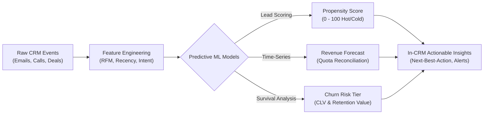

  

  
  
  
  
  
  

---

# 🚀 Awesome In-CRM Predictive Analytics

A curated ecosystem of **enterprise SaaS platforms** and **open-source machine learning projects** specializing in **In-CRM Predictive Analytics**. These tools embed predictive models directly into CRM workflows—delivering automated sales forecasting, lead propensity scoring, customer churn prevention, and next-best-action guidance without requiring external data pipelines or complex BI infrastructure.

> **Keyword Topics:** `In-CRM Predictive Analytics` • `CRM Machine Learning` • `AI Sales Forecasting` • `Predictive Lead Scoring` • `Customer Churn Prediction` • `Revenue Operations (RevOps)` • `Conversation Intelligence` • `Customer Lifetime Value (CLV)`

---

## 📑 Table of Contents

- [📊 Sector Overview & Market Dynamics](#-sector-overview--market-dynamics)
- [🏢 Enterprise SaaS Platforms](#-enterprise-saas-platforms)
  - [SaaS Feature & Pricing Comparison Table](#saas-feature--pricing-comparison-table)
- [⚡ Open-Source GitHub Projects](#-open-source-github-projects)
  - [Open-Source Solutions Ranked by Stars](#open-source-solutions-ranked-by-stars)
  - [Additional Open-Source Libraries & Packages](#additional-open-source-libraries--packages)
- [🧠 Key Architectural Concepts](#-key-architectural-concepts)
- [🤝 How to Contribute](#-how-to-contribute)
- [💖 Support & Sponsoring](#-support--sponsoring)
- [⭐ Star History](#-star-history)
- [📄 Disclaimer & License](#-disclaimer--license)

---

## 📊 Sector Overview & Market Dynamics

The global In-CRM Predictive Analytics and AI-enabled Revenue Intelligence market is estimated at **$18.4 billion in 2025**, projected to surpass **$48.2 billion by 2030** at a compound annual growth rate (CAGR) of **~21.2%**.

Market concentration is **moderately fragmented**:
- **Core Record Layer (Concentrated):** Foundational enterprise CRM data architectures remain anchored by titans (Microsoft Dynamics 365, Salesforce Einstein 1, and HubSpot), representing a concentrated core where predictive capabilities are packaged as high-tier subscription drivers.
- **Intelligence & RevOps Layer (Fragmented):** Deep predictive intelligence—such as multi-modal conversational win-rate prediction, specialized survival-adjusted churn modeling, and automated forecast reconciliation—is highly fragmented among agile specialized platforms (Gong, Clari, Aviso) and rapidly emerging open-source/self-hosted machine learning frameworks that offer complete data sovereignty.

---

## 🏢 Enterprise SaaS Platforms

Enterprise SaaS platforms integrate native machine learning into customer relationship databases, analyzing activity logs, buyer communication signals, and historical pipeline velocities.

### SaaS Feature & Pricing Comparison Table

*Sorted descending by company size (Valuation / Market Capitalization):*

| Rank | 🏢 Platform / Product | 🌐 Company Size / Valuation | 💰 Starting Tier Price | 🎁 Free Tier & Free Trial Limits | 🎯 Core In-CRM Predictive Capabilities |
| :---: | :--- | :--- | :--- | :--- | :--- |
| **1** | **[Dynamics 365 Sales Insights](https://www.microsoft.com/en-us/dynamics-365)** | **~$3.1T Market Cap** *(~$245B+ Annual Revenue)* | **$105/user/month** (Enterprise plan with base AI) or **$150/user/month** (Sales Premium with full Predictive Insights); $50/user/mo standalone add-on | **30-day free trial** with full sales pipelines, up to 25 users, sample data, and predictive lead/opportunity scoring (No credit card required; no permanent free tier) | Predictive lead and opportunity scoring, relationship health analytics, AI conversation intelligence, next-best-action coaching, and automated pipeline rollups. |
| **2** | **[Salesforce Einstein & CRM Analytics](https://www.salesforce.com/)** | **~$290B Market Cap** *(~$38B+ ARR)* | **$165/user/month** (Enterprise edition) or **$330/user/month** (Einstein 1 Sales / Unlimited with full predictive models & Data Cloud) | **30-day free trial** of Sales Cloud / Einstein 1 with pre-configured pipeline inspection, sample lead scoring, and automated insights (No credit card required; no permanent free tier) | Native Einstein Discovery models, predictive lead & deal win-rate scoring, automated revenue forecasting, and activity capture intelligence. |
| **3** | **[HubSpot Sales Hub (Breeze AI)](https://www.hubspot.com/products/sales)** | **~$32B Market Cap** *(~$2.5B ARR)* | **$90/user/month** (Professional tier, billed annually) or **$150/user/month** (Enterprise tier for automated ML predictive lead scoring) | **Free forever plan** for up to 5 users (limited to basic CRM & manual scoring); **14-day free trial** for Professional/Enterprise tiers with predictive scoring (No credit card required) | Machine learning predictive lead scoring (conversion likelihood ranking), deal health tracking, automated revenue forecasting, and Breeze Copilot sales signals. |
| **4** | **[Zoho CRM (Zia Predictive AI)](https://www.zoho.com/crm/)** | **~$12B–$15B Est. Valuation** *(~$1.4B+ ARR, 100M+ Users)* | **$40/user/month** (Enterprise edition, billed annually) or **$52/user/month** (Ultimate edition) to unlock Zia Predictive Analytics | **Free forever plan** for up to 3 users (basic contact management without Zia AI); **15-day free trial** of Enterprise edition with full Zia predictive scoring (No credit card required) | Zia AI deal win/loss prediction, lead conversion scoring, best-time-to-contact recommendations, anomaly detection, and automated sales trend predictions. |
| **5** | **[Gong Analytics & Forecast](https://www.gong.io/)** | **$7.25B Valuation** *(Series E, ~$250M+ ARR)* | **$100–$133/user/month** ($1,200–$1,600/user/year) plus annual base platform fee starting at **$5,000/year** (annual contract) | **14-day sales-assisted Proof of Concept (PoC)** sandbox trial with custom conversation ingestion and deal likelihood scoring (No permanent free tier) | Multi-modal conversation intelligence analyzing customer calls/emails to predict deal win rates, forecast quarter revenues, and flag pipeline churn risk. |
| **6** | **[Freshsales (Freddy AI)](https://www.freshworks.com/crm/sales/)** | **~$4.5B Market Cap** *(~$700M+ ARR)* | **$39/user/month** (Pro plan, billed annually) or **$69/user/month** (Enterprise plan) to activate Freddy AI Predictive Scoring | **Free forever plan** for up to 3 users (core contact/deal tracking without AI); **21-day free trial** of Pro/Enterprise tiers with full Freddy AI scoring (No credit card required) | Freddy AI predictive contact/lead scoring, deal win probability, pipeline velocity forecasting, and AI-recommended next-best-actions. |
| **7** | **[Clari Forecast & Revenue Platform](https://www.clari.com/)** | **$2.6B Valuation** *(Series F, ~$100M+ ARR)* | **$100–$120/user/month** (billed annually, ~$1,200/user/year) with standard 10–20 seat minimum contracts | **14 to 30-day guided Proof of Concept (PoC)** trial sandbox with live CRM pipeline telemetry upon RevOps sales qualification (No permanent free tier) | AI-driven revenue forecasting, predictive pipeline slip/close risk detection, opportunity inspection, and CRM data enrichment. |
| **8** | **[SugarCRM (SugarPredict)](https://www.sugarcrm.com/)** | **~$700M Valuation** *(~$120M+ ARR, Accel-KKR)* | **$85/user/month** (Sugar Sell Advanced, billed annually, 10-user minimum commitment) | **7-day free trial** of Sugar Sell environment with guided demo sandbox for SugarPredict AI scoring modules (No permanent free tier) | Deep neural network predictive lead scoring, opportunity close-date forecasting, and customer retention/churn risk detection. |
| **9** | **[Aviso AI](https://www.aviso.com/)** | **~$200M Valuation** *(~$50M+ Total Funding)* | **$50–$75/user/month** (Enterprise RevOps deployment, baseline contracts typically start at $50,000/year) | **14 to 30-day pilot / Proof of Concept (PoC)** sandbox trial with historical CRM win-rate backtesting and deal risk modeling (No permanent free tier) | Autonomous sales forecasting, AI deal guidance, predictive pipeline conversion metrics, and multi-currency revenue simulations. |
| **10** | **[BoostUp.ai (Terret)](https://www.terret.ai/)** | **~$100M Valuation** *(~$20M+ Total Funding)* | **$79/user/month** (annual revops subscription, billed annually) | **14-day guided sandbox pilot trial** with historical opportunity data and deal progression risk analysis (No permanent free tier) | Real-time sales forecast rollups, predictive risk scoring across opportunities, buyer engagement tracking, and pipeline progression AI. |

---

## ⚡ Open-Source GitHub Projects

Open-source and self-hosted tools provide data sovereignty, zero per-seat licensing fees, and direct control over model weights, training pipelines, and feature stores.

### Open-Source Solutions Ranked by Stars

*Sorted descending by GitHub star count:*

1. ### 🌟 [Twenty CRM](https://github.com/twentyhq/twenty) 
   - **Focus:** Modern Open-Source CRM & Extensible Data Architecture
   - **Tech Stack:** TypeScript, NestJS, React, PostgreSQL
   - **Highlights:** A modern open-source alternative to Salesforce. Built on a modular schema enabling developers to hook custom predictive ML scoring models, trigger retention workflows, and calculate pipeline conversion velocity directly over relational PostgreSQL data.

2. ### 🌟 [SuiteCRM](https://github.com/SuiteCRM/SuiteCRM) 
   - **Focus:** Enterprise Open-Source CRM Suite
   - **Tech Stack:** PHP, Symfony, MariaDB/MySQL
   - **Highlights:** Globally recognized enterprise open-source CRM featuring rich pipeline tracking, automated workflow triggers, historical sales reports, and modular integration capabilities for custom lead scoring models and quota forecasting.

3. ### 🌟 [Frappe CRM](https://github.com/frappe/crm) 
   - **Focus:** Modern Lead & Deal Management Platform
   - **Tech Stack:** Python, Frappe Framework, Vue.js
   - **Highlights:** Open-source CRM engineered for modern sales organizations. Includes lead qualification pipelines, deal stages, communication tracking, and native scriptability for running scikit-learn/PyTorch predictive models on customer interactions.

4. ### 🌟 [EspoCRM](https://github.com/espocrm/espocrm) 
   - **Focus:** Fast, Single-Page Application CRM & Analytics
   - **Tech Stack:** PHP, Backbone.js, MySQL
   - **Highlights:** Highly responsive CRM application with comprehensive sales pipeline forecasting dashboards, conversion funnel analytics, lead scoring rules, and REST API endpoints for external machine learning scoring services.

5. ### 🌟 [Lifetimes](https://github.com/CamDavidsonPilon/lifetimes) 
   - **Focus:** Customer Lifetime Value (CLV) & Churn Prediction
   - **Tech Stack:** Python, NumPy, SciPy, Pandas
   - **Highlights:** The gold-standard library for measuring customer lifetime value and churn probability using statistical models (BG/NBD, Pareto/NBD, Gamma-Gamma). Easily ingested into CRM database pipelines to score customer churn likelihood.

6. ### 🌟 [Customer Survival Analysis & Churn Prediction](https://github.com/archd3sai/Customer-Survival-Analysis-and-Churn-Prediction) 
   - **Focus:** Survival Analysis & Customer LTV / Churn Forecasting
   - **Tech Stack:** Python, Flask, Scikit-learn, Lifelines
   - **Highlights:** Employs Kaplan-Meier and Cox Proportional Hazards survival analysis models alongside Random Forest classifiers to predict churn timelines and residual customer lifetime value. Includes a deployable Flask API.

7. ### 🌟 [Sales Forecasting ML Toolkit](https://github.com/mollyryanruby/sales_forecasting) 
   - **Focus:** Multi-Model Revenue & Demand Forecasting
   - **Tech Stack:** Python, ARIMA, XGBoost, LightGBM, Scikit-learn
   - **Highlights:** Comprehensive implementation comparing five machine learning techniques (ARIMA, Linear Regression, Random Forest, XGBoost, and LightGBM) for predicting sales numbers based on historical trend seasonality and sales cycles.

8. ### 🌟 [Machine Learning For Predictive Lead Scoring](https://github.com/daddydrac/Machine-Learning-For-Predictive-Lead-Scoring) 
   - **Focus:** Supervised Predictive Lead Prioritization
   - **Tech Stack:** Python, Jupyter, Scikit-learn, Pandas
   - **Highlights:** End-to-end predictive lead scoring engine that extracts behavioral and firmographic signals from CRM records, calculates conversion probabilities, and surfaces high-intent opportunities for sales reps.

9. ### 🌟 [Horilla CRM](https://github.com/horilla/horilla-crm) 
   - **Focus:** Self-Hosted CRM & Enterprise Workflow Suite
   - **Tech Stack:** Python, Django, PostgreSQL, Docker
   - **Highlights:** Free and open-source CRM and HR platform released under LGPL-2.1+. Features role-based access control, REST APIs with Swagger documentation, webhook triggers for scoring events, and enterprise data security.

10. ### 🌟 [Lead Scoring Model Python](https://github.com/mukulsinghal001/lead-scoring-model-python) 
    - **Focus:** Supervised Machine Learning for Lead Conversion
    - **Tech Stack:** Python, Logistic Regression, Random Forest, Statsmodels
    - **Highlights:** Real-world case study and production pipeline utilizing supervised classification to generate lead scores (0–100 scale), complete with precision-recall trade-off tuning and ROC-AUC curve analysis.

11. ### 🌟 [LeadGenius](https://github.com/Astoriel/LeadGenius) 
    - **Focus:** Open-Source B2B Lead Scoring & Routing Engine
    - **Tech Stack:** Go, Docker, YAML, Slack/HubSpot Integrations
    - **Highlights:** Self-hosted open-source alternative to Clearbit and MadKudu. Provides waterfall enrichment, YAML-based transparent scoring formulas, and automated routing of qualified leads directly to CRM pipelines and Slack notifications.

12. ### 🌟 [ChurnGuard AI](https://github.com/ShreyasDasari/churnguard-ai) 
    - **Focus:** Automated SaaS Customer Churn Prediction
    - **Tech Stack:** Python, XGBoost, LightGBM, SMOTEENN
    - **Highlights:** Plugs into SaaS customer data via standard CSV schemas or HubSpot/Stripe webhooks. Leverages XGBoost and LightGBM models with SMOTEENN resampling to classify accounts into Critical/High/Medium/Low risk tiers with revenue retention calculations.

13. ### 🌟 [AI-Driven CRM Analytics System](https://github.com/Isha2605/AI-Driven-CRM-Analytics-System) 
    - **Focus:** Full-Stack AI CRM with Lead Classification & Chatbot
    - **Tech Stack:** Python, Flask, PyTorch, Scikit-learn, MySQL
    - **Highlights:** Full-stack CRM combining employee performance predictions, conversational PyTorch assistants, and lead scoring models achieving 82% classification accuracy using KNN and Feedforward Neural Networks across customer datasets.

14. ### 🌟 [CallSense (ML Voice Lead Analysis)](https://github.com/aaron-seq/ML-voice-lead-analysis) 
    - **Focus:** Self-Hosted Sales Conversation Intelligence
    - **Tech Stack:** Python 3.11, NLP, Whisper, BANT/MEDDIC
    - **Highlights:** Self-hosted speech-to-intent analysis for sales call recordings. Parses conversation transcripts to score buyer intent (0–100 scale), detects 7 objection categories, flags missing decision-makers, and outputs next-best-actions without data leaving your VPC.

15. ### 🌟 [SalesIQ](https://github.com/badrr06/SalesIq) 
    - **Focus:** Modular Sales Management & Time-Series Forecasting
    - **Tech Stack:** Python, Flask, SQLAlchemy, Chart.js, ARIMA
    - **Highlights:** Clean and lightweight CRM interface for small businesses providing product catalogs, order management, KPI analytics, and monthly 6-month sales forecasting using ARIMA and linear models.

---

### Additional Open-Source Libraries & Packages

- **[CRMlytics](https://wordpress.org/plugins/crmlytics/)** — Free WooCommerce CRM plugin embedding local machine learning to compute 0–100 customer health scores, RFM segmentation, and 30/90/180-day repeat purchase predictions without third-party APIs.
- **[b2b-revenue-forecasting](https://pypi.org/project/b2b-revenue-forecasting/)** — Python package for hierarchical quota cascading, CommitReconciler bias compensation, and ML baseline blending with interactive HTML dashboards.
- **[afrikana-analytics](https://pypi.org/project/afrikana-analytics/)** — Production-ready analytical package featuring gradient boosted churn scoring, survival-adjusted CLV computation, and Monte Carlo revenue simulations.
- **[lead-scoring-ai-mcp](https://www.npmjs.com/package/lead-scoring-ai-mcp)** — Model Context Protocol (MCP) server for scoring B2B leads based on firmographic signals and conversion probabilities directly in LLM agent workflows.

---

## 🧠 Key Architectural Concepts

| Domain | Typical Algorithms | Primary Target Variable | RevOps Business Outcome |
| :--- | :--- | :--- | :--- |
| **🎯 Predictive Lead Scoring** | XGBoost, LightGBM, Logistic Regression, Feedforward NNs | Probability of deal conversion (0.0 to 1.0) | Focus SDR/AE time on highest-converting accounts; 25%+ win-rate increase. |
| **📈 Sales & Revenue Forecasting** | ARIMA/SARIMAX, Prophet, Hierarchical Quota Blending | Projected revenue closed by end of quarter ($) | Remove forecast sandbagging; improve forecast accuracy to within ±5%. |
| **🛡️ Customer Churn Prediction** | Survival Analysis (Cox PH), Random Forest, CatBoost | Probability of cancellation within 30/60/90 days | Proactive customer success intervention before contract renewal date. |
| **💬 Conversation Intelligence** | Transformer Speech Models, LLM Intent Extractors | Buyer intent signals (BANT/MEDDIC), deal risk flags | Automatic CRM note logging and real-time deal stall warning. |

---

## 🤝 How to Contribute

Contributions are warmly encouraged! Help keep this repository the most comprehensive and factual resource for predictive CRM analytics:

1. **Fork the repository** to your own GitHub account.
2. **Add or update an entry** in `README.md` following the existing format.
   - For SaaS tools: include verified starting tier pricing, free trial specifications, and company size/valuation.
   - For open-source tools: include the repository link, star badge, technology stack, and architectural capabilities.
3. **Ensure factual accuracy** and link to official websites or public GitHub repositories.
4. **Submit a Pull Request** with a descriptive title and explanation.

---

## 💖 Support & Sponsoring

Thank you for visiting and supporting **Awesome-In-CRM-Predictive-Analytics**!

If you find this curated directory valuable for your Revenue Operations team, data science research, or CRM engineering stack, please consider:
- ⭐ **Starring this repository** to help others discover it
- 🍴 **Forking and contributing** your favorite tools or predictive models
- 📢 **Sharing** with your revops colleagues and machine learning communities

Support ongoing research, updates, and maintenance:  
  
👉 **[Buy me a coffee on GitHub Sponsors](https://github.com/sponsors/ishandutta2007)**

---

## ⭐ Star History

---

## 📄 Disclaimer & License

- **Disclaimer:** This is a community-curated directory intended for educational and architectural evaluation. Product names, logos, valuations, and trademarks are property of their respective owners. Predictive analytics implementations must comply with GDPR, CCPA, and applicable AI transparency guidelines.
- **License:** Released under the [MIT License](LICENSE).
